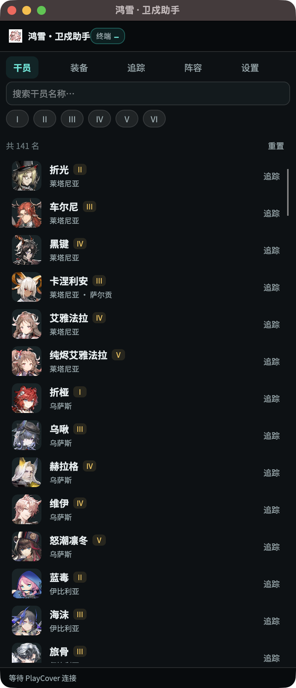
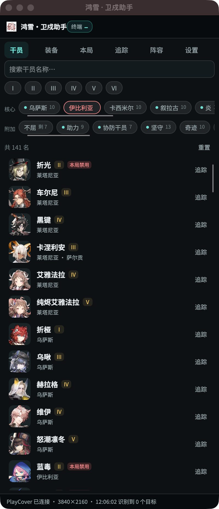
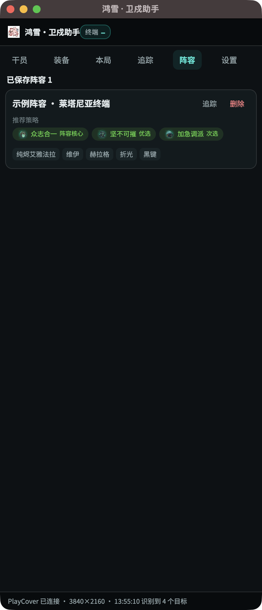
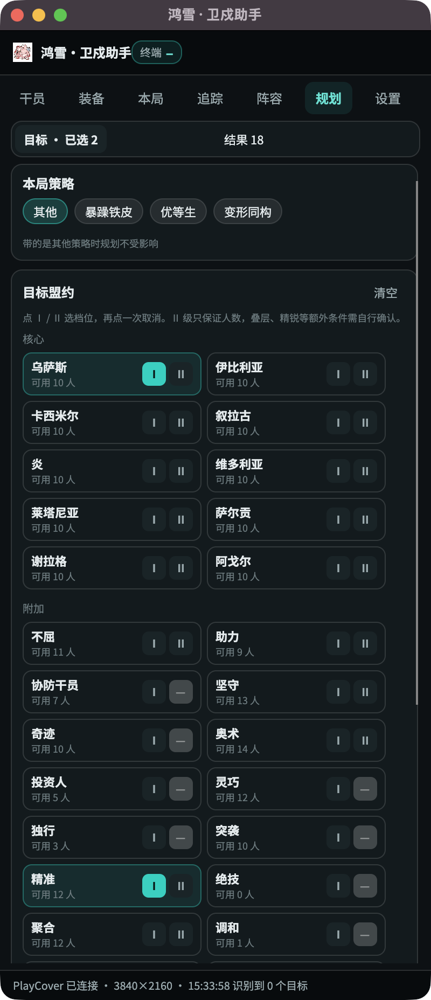
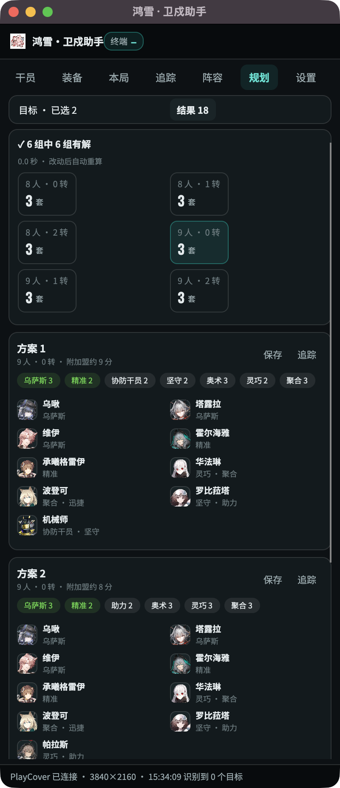
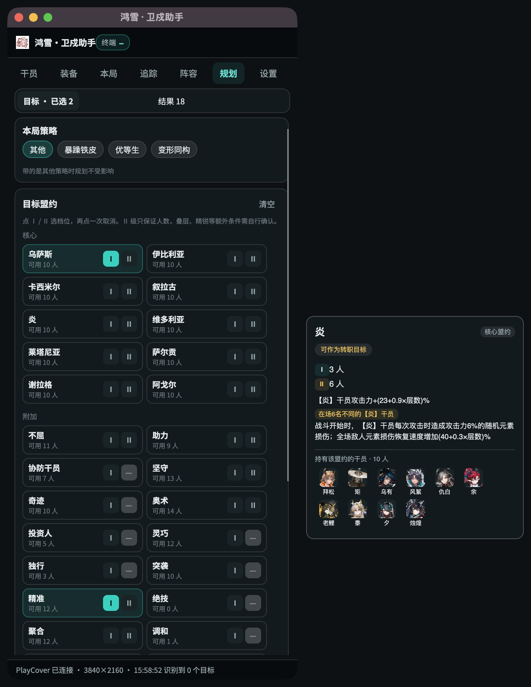

# macOS 移植说明（Hongxue Stronghold Companion · Mac）

这份文档记录把原本只支持 Windows（WPF / .NET 8）的鸿雪·卫戍助手移植到 Apple Silicon macOS 的过程、当前进度和已知限制。
Windows 版本保持原样可用：`src/ASPAssistant.App` 仍按 `net8.0-windows` 构建，本次改动只在共享的 `ASPAssistant.Core`
中加入了平台分支。

## 界面截图

以下截图由 macOS 版直接渲染（深色 Terminal 主题）：

<p align="center">
  
  
  
  
  
  
  
  
  
  
</p>

## 现在能做什么

| 功能 | macOS 状态 |
| --- | --- |
| 干员浏览（搜索、等阶筛选、盟约筛选、头像列表） | ✅ |
| 装备浏览（搜索、等阶/分类筛选） | ✅ |
| 追踪列表（干员/装备、过渡/精锐标记、已获取、移除、清空） | ✅ |
| 已保存阵容列表（查看干员、推荐策略、一键追踪、删除） | ✅ |
| 阵容规划：Ⅰ／Ⅱ 目标 × 8/9 人 × 0~2 次转职候选搜索，必带干员、本局策略、Ban 联动，结果可保存/追踪 | ✅ |
| 阵容导入：粘贴森空岛攻略链接，或复制 Windows 端的阵容 JSON | ✅ |
| 通过 PlayCover MaaTools 连接游戏（截图 + 触摸） | ✅ |
| 通过 ADB 连接模拟器 | ✅（与 Windows 同一套 MaaAdbController 逻辑） |
| 商店识别：名称栏 OCR + **本局全部在售商品列表**（点一下加入追踪） | ✅ |
| 自动扫描（启动即开始，可在追踪页关闭） | ✅ |
| 商店主题：手动选择（自动指纹识别可选，PlayCover 下阈值放宽） | ✅ |
| 深色/浅色主题、识别主题选择、连接设置 | ✅ |
| 本局信息识别：Ban 盟约 / 禁用干员 / 敌方领袖（游戏内放大镜页面），打开页面自动识别 | ✅ |
| 干员页联动：本局禁用标记、盟约 chip 禁用态、只看本局可用 | ✅ |
| 道中路线（开局 → 大成阶段推演） | ⛔ 未移植（Core `LineupRoutePlanner` 可直接复用，缺 Avalonia 版阶段渲染） |
| 游戏内叠加层（商店整卡高亮） | 🟡 原型：已实机验证对齐，默认关闭 |
| 站位规划 / 地图模拟 | ⛔ 未移植 |
| 阵容编辑器（手动编辑槽位/精锐/装备） | ⛔ 未移植（规划结果可直接保存；也可读取 Windows 端阵容 JSON） |
| 全局快捷键、托盘、自动更新 | ⛔ 未移植 |

`data/`、追踪状态、阵容目录的 JSON 格式与 Windows 版一致：把 Windows 的
`%AppData%\ASPAssistant\` 拷到 macOS 的 `~/Library/Application Support/ASPAssistant/` 即可复用追踪与阵容。

## 技术方案

```
src/ASPAssistant.Core      net8.0-windows（原 WPF 端） + net8.0（macOS）
  ├─ ViewModels / Models / Data / Services   纯托管逻辑，两端共用
  ├─ Services/Imaging/Raster.cs              SkiaSharp 图像层（替代 System.Drawing/GDI+）
  └─ Services/GameConnectionService.cs       三种截图源：PC 窗口 / ADB / PlayCover
src/ASPAssistant.App       WPF 界面（Windows，未改动构建目标）
src/ASPAssistant.Mac       Avalonia 11 界面（macOS）
```

关键决定：

1. **Core 多目标**：`<TargetFrameworks>net8.0-windows;net8.0</TargetFrameworks>`。Win32 相关代码
   （`Interop/User32.cs`、`WindowTrackerService`、`MaaScrollService`、GDI 截图）用 `#if WINDOWS` 隔离，
   macOS 目标里不参与编译。`RECT` 抽到平台无关的 `Interop/RECT.cs`，窗口几何计算两端共用。
2. **图像层换 SkiaSharp**：`System.Drawing.Common` 在 .NET 8 之后只能在 Windows 上运行。
   新增 `Raster`（解码 PNG/BMP、双三次缩放、裁剪、合成、PNG/BMP 编码、直接读 BGRA 像素），
   把 `ImageBytes`、`ShopReader`、`ScreenshotNormalizer`、`GameShopThemeDetector`、`BanIconGrid`、
   `BanCovenantReader`、`MaaOcrEngine`、`MaaCardDetector` 全部改为使用它。
   像素布局保持 GDI+ 的 BGRA 直通顺序，颜色判据（绿色占比、亮度、红色通道对比矩阵）逐行保留。
3. **PlayCover 连接**：MaaFramework 5.8 自带 `MaaPlayCoverController`（封装
   `libMaaPlayCoverControlUnit`），它直接与 PlayTools 的 MaaTools TCP 服务通信（默认 `127.0.0.1:1717`），
   协议包含截图、坐标、触摸，**不需要 adb**。`GameConnectionService` 新增 `GameCaptureSource.PlayCover`，
   截图路径与 ADB 共用（Screencap → MaaImageBuffer → 缩放 → PNG），触摸/滑动复用同一个控制器。
4. **界面重写**：WPF 的 `WindowChrome`、`HwndSource` 热键、`RenderTransform` 动画、`Style`/`DataTrigger`
   在 Avalonia 里没有等价物，因此没有逐文件翻译 XAML，而是复用 Core 的 ViewModel 重写了一个紧凑的侧栏界面
   （400×900，五个标签页），视觉沿用 Terminal 深色主题的配色。

## 构建与运行

需要 .NET 8+ SDK（`brew install dotnet`，本机为 10.0.400，靠 RollForward 运行）和 Xcode 命令行工具（`sips`/`iconutil`/`codesign`）。

```bash
# 开发运行（框架依赖，直接跑）
dotnet build src/ASPAssistant.Mac/ASPAssistant.Mac.csproj
dotnet src/ASPAssistant.Mac/bin/Debug/net8.0/HongxueStronghold.dll

# 打包成自包含 .app（推荐；产物在 dist/）
scripts/build-mac.sh          # 构建 + 打 bundle
scripts/build-mac.sh --run    # 构建 + 打 bundle + 打开
```

`scripts/build-mac.sh` 产物为 `dist/鸿雪·卫戍助手.app`：自包含运行时、`Contents/MacOS/data` 数据目录、
由 `data/icons/aspa_logo.png` 生成的 `AppIcon.icns`，最后做 ad-hoc 签名。

> 用 `brew` 装的 .NET 没有 `/usr/local/share/dotnet` 符号链接时，直接执行 apphost 会报
> “You must install .NET”。打包版是自包含的，不受影响；如果跑框架依赖版，设置
> `DOTNET_ROOT=/opt/homebrew/Cellar/dotnet/<version>/libexec`。

## PlayCover 设置步骤

1. PlayCover 里右键「明日方舟」→ 设置（或 PlayCover 设置里的应用设置）→ 勾选 **MaaTools**，端口保持 `1717`。
2. 启动游戏。游戏窗口标题会追加 `[localhost:1717]`，说明 MaaTools 服务已就绪。
3. 在助手「设置 → 游戏连接」里确认来源是 **PlayCover（MaaTools）**、地址 `127.0.0.1:1717`、
   Bundle ID `com.hypergryph.arknights`，点 **测试连接**。成功时状态栏显示
   `PlayCover 已连接 · <宽>×<高>`。
4. 游戏分辨率需为 16∶9 横屏（PlayCover 显示设置里选 1080p），否则会提示“请设置为横屏 16∶9”。
5. 打开游戏商店 → 助手启动时会自动扫描（每 3 秒）；也可点 **扫描当前商店** 手动刷新。
   卡片里会列出**本局在售的全部商品**，点「+ 名称」加入追踪，已追踪的显示为绿色「✓ 名称」。
   不在商店或未连接时只提示、不改动追踪记录。

## 验证记录（2026-11-14）

**自动识别（2026-11-14 12:21）**：打开信息页后无需点击，商店扫描发现画面不是商店时会用
`InformationScreenDetector` 判断「核心盟约 + 附加盟约」两个标题，命中后自动跑一次分析（同一画面按帧哈希去重）。
日志实测 `Panel read after 0 scroll(s): core=8, additional=10, needsScroll=False`，自动禁用干员 56 名。

**Ban 规则修正（2026-11-14，按游戏内分组核对）**：游戏里每个干员在调度中心只归属**一个**核心盟约，
禁用列表也按这个归属分组。实测：哈洛德（维多利亚+谢拉格）不在维多利亚组、烛煌（炎+维多利亚）不在维多利亚组，
锏 / 卡涅利安 在莱塔尼亚组。因此：

- 主核心盟约被 ban → 干员禁用，归入该盟约组；
- 没有主核心盟约的干员（无核心，或主核心是未抽到的盟约）再按被 ban 的附加盟约判定；
- 多核心盟约干员的主盟约在 `CovenantBanRules.PrimaryCovenant` 里按实测整理（锏/卡涅利安/薇薇安娜/复奏→莱塔尼亚，
  哈洛德→谢拉格，烛煌→炎）；
- 未选中的「自选干员」不计入。

最终规则（与游戏内逐组核对一致，2026-11-14 第二局）：

1. 有主核心盟约的干员：主盟约被 ban → 禁用，归入该核心盟约组；
2. 无核心盟约的干员：只有在**所有**附加盟约都不可用（被 ban 或本局没抽到）时才禁用；
3. 被禁用的干员，若持有被 ban 的附加盟约，会**同时**出现在对应的附加盟约组里
   （游戏内也是这样，例如纯烬艾雅法拉同时在莱塔尼亚和远见组）；
4. 没抽到的核心盟约不会生成禁用组，其干员只是不出现在调度中心。

第二局实测（10 个核心盟约全抽到、ban 5 核心 + 5 附加）：app 分组
炎 10 / 维多利亚 8 / 叙拉古 9 / 乌萨斯 10 / 伊比利亚 10 + 远见 6 / 奥术 9 / 精准 7 / 坚守 4 / 灵巧 5，
与游戏内**逐组一致**；图标合计 78，去重后禁用 59 名干员。第一局（低难度、只抽到 8 个核心盟约）
核心组也一致，附加组少 1~2 个，属于赛季数据与线上卡池的细微出入。

**真机联调（本局信息页，2026-11-14 12:05）**：点开游戏内左上角放大镜（回合数左边）的信息页，
点「本局」页的「识别本局信息」→ 1.8 秒内读出：核心禁用 萨尔贡 / 维多利亚 / 伊比利亚 / 莱塔尼亚，
附加禁用 远见 / 不屈，本局可用核心 炎 / 谢拉格 / 叙拉古 / 乌萨斯，敌方领袖 盐风主教昆图斯，
特训敌人·复苏 / 隐盾，禁用干员 27 名；干员页同步显示「本局禁用」红标与盟约 chip 的禁用态。
点击放大镜本身也是用 `GameConnectionService.Tap` 完成的（4K 坐标 980,96）。

**真机联调（PlayCover 4K 商店）**：本机 PlayCover 版《明日方舟》开启 MaaTools，`MaaPlayCoverController` 连上
`127.0.0.1:1717`，捕获 `3840×2160` 画面（OCR 前缩到 1920×1080）。在卫戍协议商店页识别出
「随身身份牌 / 拜松 / 褐果 / 摆渡人」，追踪的 3 个目标（随身身份牌、拜松、褐果）在助手「追踪」页显示为
“在售 3”，状态栏同步显示 `PlayCover 已连接 · 3840×2160 · 识别到 3 个目标`；点击/滑动通过触摸序列下发。
另一张开局签到页正常截取，说明连接与解码不依赖具体界面。

注意：商店主题的**指纹自动识别**在 PlayCover 4K 渲染下未命中（店主立绘与 UI 缩放都和 Windows 1080p
参考图不同；实测 Terminal=39.1、Ursus=25.3，均高于阈值 22）。macOS 版因此把自动识别做成可选（默认关闭），
沿用设置页手动选择的主题；终端主题下名称栏读取正常。

- `dotnet build src/ASPAssistant.Core -f net8.0` 与 `-f net8.0-windows` 均通过。
- `dotnet build src/ASPAssistant.App -f net8.0-windows -p:EnableWindowsTargeting=true` 通过（Windows 端未被破坏）。
- `tools/PlayToolsMock` 用进程内的 MaaTools 协议模拟服务器（握手 `MAA\0` → `OKAY`、`VERN`/`SIZE`/`SCRN`/`TUCH`）
  跑通完整 PlayCover 链路：`MaaPlayCoverController` 截图 1920×1080 → 商店 OCR 4/4 命中 → 主题 Terminal →
  点击/滑动正确下发触摸事件。结果为 `PLAYCOVER PATH PASS`。
- `tools/MacProbe` 在 macOS 上用真实 PaddleOCR 模型跑 `src/ASPAssistant.Tests/TestData` 里的 6 张商店截图：
  6/6 通过，名称与 `SHOP_SAMPLES.md` 记录一致；主题判定 Terminal/Ursus 正确。
- `MaaPlayCoverController` 在无服务时可以给出明确的连接失败提示；有服务时的实机联调见下文“待办”。

**阵容规划（2026-11-14）**：`tools/MacProbe` 新增 8 项离线检查，直接用 macOS 版同一套 Core 代码跑通
「目标 → 搜索 → 保存 → 追踪 → Ban 同步」：

```
PLANNER SEARCH PASS · 目标 乌萨斯 3、精准 2 · 6/6 组有解 · 当前 3 套候选
PLANNER STRATEGY PASS · 暴躁铁皮 8 组 / 4 档转职
PLANNER SAVE PASS · “规划 乌萨斯Ⅰ 精准Ⅰ 9人0转” 9 个槽位
PLANNER TRACK PASS · 9 名干员加入追踪
PLANNER BAN PASS · 核心盟约“乌萨斯”本局已被 Ban。
PLANNER BAN SYNC PASS · 乌萨斯 禁用=True 已选=0 剩余目标=1
```

界面侧用 `.run-settings` 的开发变量启动实机进程验证：`规划` 页在 400px 窄栏下渲染目标瓷砖
（两列、Ⅰ/Ⅱ 档位、可用人数、禁用红框）、6 个组合格与候选卡片；点「保存」后 `lineups/` 写入
`规划 乌萨斯Ⅰ 精准Ⅰ 9人0转`（9 个槽位），「阵容」页随即列出该阵容；「追踪」写入 9 名干员并落盘
`tracking.json`。截图见 `docs/images/mac/planner-goals.png`、`planner-results.png`。

悬停卡片用 CuaDriver（`/Applications/CuaDriver.app`，`cua-driver call` / AX 元素 token）在真机上驱动验证：
真实指针进入盟约瓷砖 / 干员行 → 320ms 后卡片出现在面板右缘；卡片内容与 `MacProbe` 读到的数据一致
（炎：Ⅰ 3 人 / Ⅱ 6 人、两条效果、10 名持有者；乌啾：医疗·链愈师、奶位·叠层【乌萨斯】、普通/精锐特性与技能）；
移出窗口、点击页面、滚轮都会让卡片消失，切到别的条目会换内容。截图见 `docs/images/mac/planner-hover.png`。
（踩到的三个坑：Avalonia 里 `Popup` 的 `ContentPresenter` 必须显式 `ContentTemplate` + 显式 `DataContext`，
以及模板里漏掉 `Tier` 转换器会让弹层渲染成空卡片；`DockPanel` 行要 `Background="Transparent"` 才参与命中测试。）

## 阵容从哪来

macOS 版没有阵容编辑器，阵容来自三处：

1. **规划结果**：「规划」页选好目标后，候选卡片上的「保存」会写成一套阵容（含计划转职的变形同构体与转职装备）。
2. **导入森空岛攻略**：阵容页右上角「导入」→ 粘贴 `game.skland.com/arknights/stronghold-guide/detail?guideId=…`
   形式的攻略详情链接；解析出的干员、阶段、推荐策略会写入 `~/Library/Application Support/ASPAssistant/lineups/`。
3. **从 Windows 复制**：把 `%AppData%\ASPAssistant\lineups` 里的 JSON 拷到上面的目录，重启后出现。

Ban 位录入只影响干员页的可用性标记和规划的目标可选性，不会自己生成阵容。

## 阵容规划（macOS）

「规划」标签页复用 Core 的 `LineupPlannerViewModel` / `LineupPlanner`（与 Windows 端同一份搜索代码），
Avalonia 端只负责重画界面：`Views/PlannerPage.axaml` + `PlannerPage.axaml.cs`。

- **目标**：核心/附加盟约各一块，点 Ⅰ / Ⅱ 选档位（再点一次取消）。被 Ban 的核心盟约不可选；被 Ban 的附加盟约
  仍可由剩余持有者凑人数，但 Ⅱ 档凑不满时只提供 Ⅰ。Ⅱ 档依赖叠层/精锐等条件的盟约标注“规划不提供 Ⅱ 级效果”。
- **本局策略**：其他 / 暴躁铁皮 / 优等生 / 变形同构；暴躁铁皮可勾选精锐（转 5 个盟约），
  转职档位随之变成 0~3。
- **必带干员**：输入名称回车或点建议；「从追踪导入」把当前追踪的干员一次性固定。
- **结果**：人数×转职 6（暴躁铁皮 8）个组合各自显示候选数，选中后列出候选卡片：目标盟约标签
  （绿色）、其他已激活盟约、干员两列头像 + 契约/转职/必带标记，底部提示奶位缺失、非必要转职等。
  「保存」写入 `lineups/`（回到「阵容」页可见），「追踪」按当前多队伍设置合并进追踪列表，状态栏给出一行反馈。
- **悬停详情**：悬停目标盟约 → 卡片显示档位要求（Ⅰ/Ⅱ 人数）、本局可用 / 被 Ban / 可转职标记、游戏内效果
  （含 `<条件>` 行）、Ban 说明，以及全部持有者头像（本局不可用的变灰加删除线）；悬停候选里的干员 → 显示职业 /
  子职业 / 位置 / 阻挡、盾奶叠等定位、盟约、必带 / 转职 / 调和提示，以及**普通 / 精锐**各自的特性与技能
  （消耗、初始、持续、描述）。悬停 320ms 后弹出，卡片贴在面板右缘、纵向跟随所悬停的条目，移开 / 点击 / 滚轮即收起。
- **Ban 联动**：本局信息识别完成后 `PlannerVm.SetAvailableCovenants(...)`，Ban 变化会自动取消被禁的核心目标并重算；
  规划页隐藏时只标记过期，切回来再算（`IsActive`）。
- 未提供 Windows 端的「道中路线」推演；候选卡片也不再需要「展开」，窄栏下直接常驻两列干员。
  `SelectGoal` 这个公开方法用于按名称选中目标，界面与测试共用。

## 策略与筛选顺序

- 阵容页会显示该阵容自带的推荐策略：图标 + 名称 + 标签（阵容核心 / 优选 / 次选），按标签排序，
  悬停显示效果描述、初始生命、解锁条件与发起人（来自 `data/strategies.json` 的 61 条策略）。
- 干员页的盟约 chip 在识别到 ban 之后自动把**被禁用的盟约排到后面**，可用的排在前面（保持原有顺序）。

## 已知限制

- 触控走 MaaFramework 内建路径：控制单元声明 `UseMouseDownAndUpInsteadOfClick` 后，
  `MaaController.Click/Swipe` 会被 ControllerAgent 自动展开成 touch_down/move/up（自带 10ms 插值节奏），
  不需要自己拼触摸序列。`GameConnectionService.Tap/Swipe/ScrollInformationPanelDown` 现在直接调用它们，
  已用模拟 MaaTools 服务验证（点击→down+up，滑动→24 个触摸事件）。
- 本局信息（Ban 位）不随应用重启保留；游戏内放大镜页面不限时，可随时重新识别。
- 信息页可滚动。识别时的下拉采用「小步长 + 等待 400ms」的方式（每次约 6% 屏高），每步重新读一遍面板，
  未确认完整就继续读，最多三次；手工拖动游戏面板时如果一次拖太多，确实可能漏读，请小步拖。
- 商店识别沿用 16∶9、以 1080p 为基准的相对坐标；本机 4K PlayCover 实机已验证终端主题，其他分辨率/界面缩放仍需实机验证。
- 商店主题自动识别默认关闭（设置页可开）：PlayCover 4K 帧下正确主题得分约 25（1080p 参考图为 4~5），
  因此 macOS 侧把绝对阈值放宽到 30，并要求与次优主题相差 ≥8；实测本机帧判定为 Ursus（乌萨斯簇）正确。
- 叠加层是原型：透明、置顶（NSStatusWindowLevel）、鼠标穿透（`ignoresMouseEvents=YES`）、每 250ms
  跟随 PlayCover 游戏窗口；商店里追踪中的目标会画出整张卡的高亮框 + 名称徽标。
  卡框位置由 OCR 名称框反推：卡宽 ≈ 0.0781 屏宽、卡顶在名称框上方 ≈ 0.183 屏高，底边贴屏幕底部。
  实测（2026-11-14）3 个追踪目标「雪祀之衣 / 地灵 / 摆渡人」的高亮框与商店卡对齐，窗口移动后同步。
- 自动更新、托盘、全局快捷键依赖 Windows API，macOS 版暂未提供。

### 叠加层实现要点

- `Overlay/GameWindowLocator.cs`：`CGWindowListCopyWindowInfo` 找到 owner 为「明日方舟」的窗口
  （不需要屏幕录制权限，只有窗口标题受限），`CGRectMakeWithDictionaryRepresentation` 取 bounds（points）。
- 游戏内容是 16:9 且位于标题栏下方：`contentH = contentW * 9 / 16`，`top = window.Y + (window.H - contentH)`。
- `Overlay/NativeOverlay.cs`：通过 `objc_msgSend` 设置 `setIgnoresMouseEvents:`（鼠标穿透）、
  `setLevel: 25`、`setCollectionBehavior:`、`setOpaque: false`、`setHasShadow: false`。
  Avalonia 的平台句柄是 `AvnWindow`（NSWindow 子类），用 `respondsToSelector:` 判断而不是类名。
- Avalonia 的 `Window.Position` 在 macOS 上按屏幕 points 处理（与 CGWindowList 同单位），不要再乘缩放。
- 标记位置直接来自 `ShopItem.OcrRegion`（相对截图的归一化坐标）× 叠加层尺寸。

## 发版（macOS）

`.github/workflows/release-mac.yml` 只构建 macOS 版本：

1. 打一个 `mac-v` 开头的 tag（如 `mac-v1.0.0`）并推送，或在 Actions 里手动运行并填 tag；
   Windows 版本仍用 `v*` tag，两者互不触发；
2. 工作流先跑两个离线测试（`tools/MacProbe` 的 6 张商店样本 + `tools/PlayToolsMock` 的协议链路），
   再用 `scripts/build-mac.sh` 打出 `.app`（版本号取自 tag，`CFBundleVersion` 用运行编号）；
3. 校验 bundle：可执行文件、图标、`data/operators.json`、OCR 模型、三份许可文件、`Info.plist` 版本、
   `codesign --verify`，并确认 `runtimes/` 只剩 `osx-arm64`；
4. 用 `ditto` 打包成 `HongxueStronghold-macOS-arm64-<tag>.zip`，生成 `SHA256SUMS-macos.txt`，
   上传到该 tag 的 GitHub Release（macOS 独立 Release，说明取自 `RELEASE_NOTES-mac.md`）。

本地等价命令：

```bash
VERSION=1.0.0 BUILD_NUMBER=1 scripts/build-mac.sh
cd dist && ditto -c -k --keepParent "鸿雪·卫戍助手.app" out.zip
```

> 构建脚本会把 `Maa.Framework.Runtimes` 里其他平台的原生库删掉，只保留 `osx-arm64`：
> `.app` 从 502MB 降到 231MB，zip 从 227MB 降到 128MB。

**签名说明**：发布包只做 ad-hoc 签名、没有公证。首次打开如果被 Gatekeeper 拦下，
右键 →「打开」，或执行：

```bash
xattr -dr com.apple.quarantine "鸿雪·卫戍助手.app"
```

## 开发工具

| 工具 | 用途 |
| --- | --- |
| `tools/MacProbe` | 冒烟测试：SkiaSharp 编解码、MaaFramework OCR、6 张商店样本、主题判定、追踪存取、阵容规划（搜索/策略/保存/追踪/Ban 同步） |
| `tools/PlayToolsMock` | PlayCover 协议集成测试：模拟 MaaTools 服务，验证截图、OCR、触摸、滑动 |
| `tools/PlayCoverProbe` | 真机探针：截图/主题分数/商店 OCR（`--watch`）、`--ban` 跑本局信息识别、`--tap x y`/`--swipe x1 y1 x2 y2` 发触摸（坐标以 1920×1080 为基准） |
| `tools/mac-dev/shot.sh <tab> <out.png>` | 启动已构建的 app 并截取指定标签页窗口（`operators`/`equipment`/`tracking`/`lineups`/`planner`/`settings`） |
| `ASPASSISTANT_MAC_START_PAGE` | 指定启动标签页（开发调试） |
| `ASPASSISTANT_MAC_PLANNER_GOALS` | `乌萨斯:1,精准:1` 形式预选规划目标（macOS 没有点击自动化，截图用） |
| `ASPASSISTANT_MAC_PLANNER_SHOW` | 设为 `results` 时启动即显示规划结果页 |
| `ASPASSISTANT_SETTINGS_DIR` | 指定配置目录，避免污染 `~/Library/Application Support/ASPAssistant` |

```bash
dotnet run --project tools/MacProbe/MacProbe.csproj        # 6 张商店样本
dotnet run --project tools/PlayToolsMock/PlayToolsMock.csproj   # PlayCover 协议链路
```

CI：`.github/workflows/mac-build.yml` 在 `macos-14` 上构建 Core/Avalonia 并跑上面两个离线测试。

## 后续可做

1. 开局信息页的自动检测（现在手动点「识别本局信息」；Core 的 `OcrScannerService` 已有自动检测逻辑）。
2. 游戏内叠加层：用 CoreGraphics 窗口列表跟踪 PlayCover 游戏窗口位置，叠一个无边框透明窗口显示商店标记。
3. 阵容编辑器（手动改槽位/精锐/装备）与道中路线推演：`LineupEditorViewModel`、`LineupRoutePlanner` 都在 Core 里，
   缺的是 Avalonia 版编辑器与阶段视图；规划结果已经可以直接保存成阵容。
4. 站位规划/地图模拟（Core 的 `PlacementPlanner`、`GarrisonBoardStore` 均可直接复用，缺 Avalonia 版棋盘渲染）。
