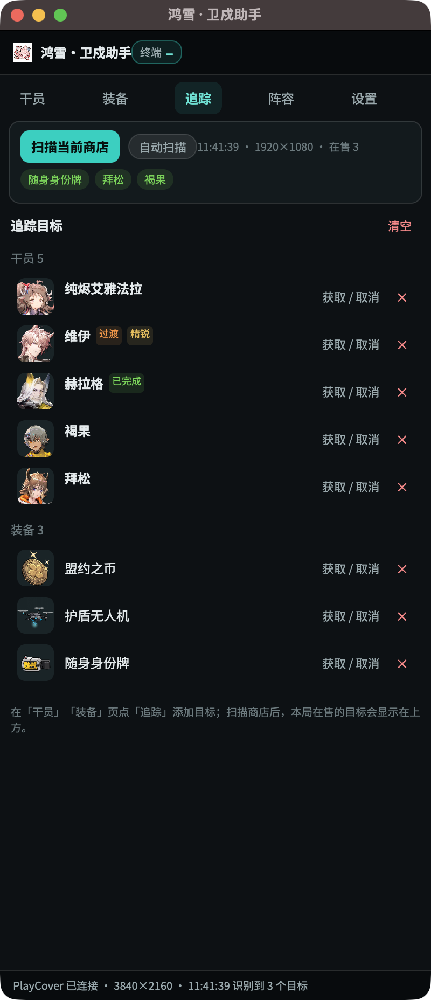
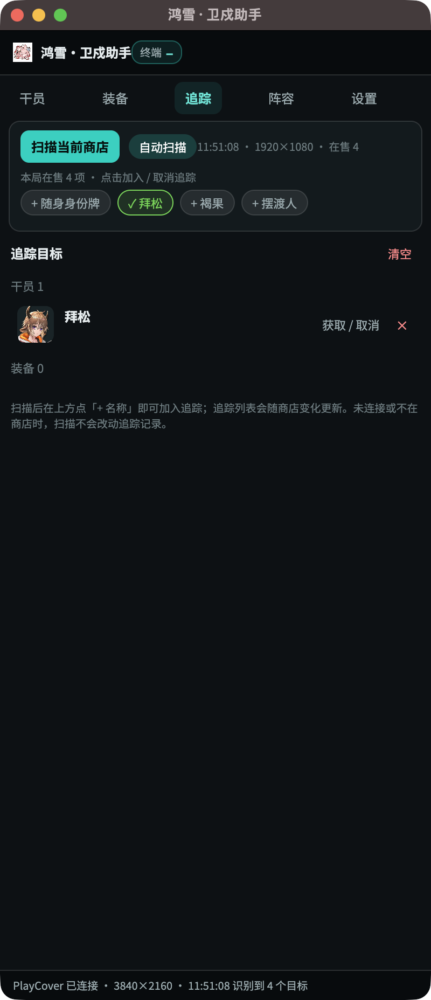
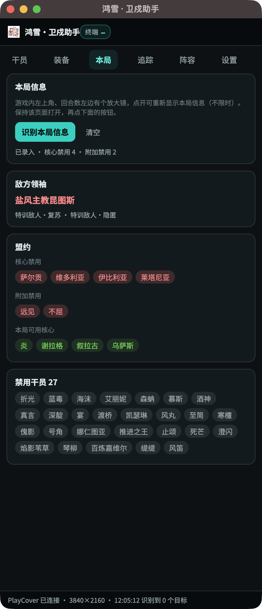
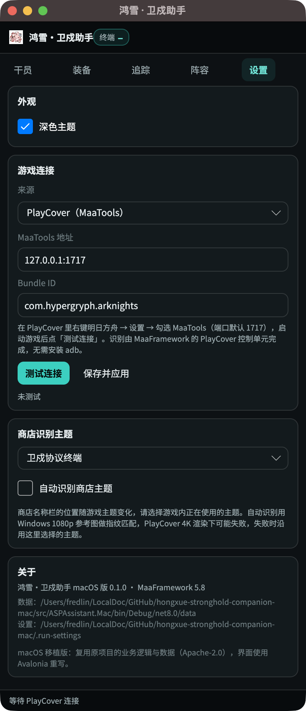

# macOS 移植说明（Hongxue Stronghold Companion · Mac）

这份文档记录把原本只支持 Windows（WPF / .NET 8）的鸿雪·卫戍助手移植到 Apple Silicon macOS 的过程、当前进度和已知限制。
Windows 版本保持原样可用：`src/ASPAssistant.App` 仍按 `net8.0-windows` 构建，本次改动只在共享的 `ASPAssistant.Core`
中加入了平台分支。

## 界面截图

以下截图由 macOS 版直接渲染（深色 Terminal 主题）：

<p align="center">
  
  
  
  
  
  
</p>

## 现在能做什么

| 功能 | macOS 状态 |
| --- | --- |
| 干员浏览（搜索、等阶筛选、盟约筛选、头像列表） | ✅ |
| 装备浏览（搜索、等阶/分类筛选） | ✅ |
| 追踪列表（干员/装备、过渡/精锐标记、已获取、移除、清空） | ✅ |
| 已保存阵容列表（查看干员、一键追踪、删除） | ✅ |
| 通过 PlayCover MaaTools 连接游戏（截图 + 触摸） | ✅ |
| 通过 ADB 连接模拟器 | ✅（与 Windows 同一套 MaaAdbController 逻辑） |
| 商店识别：名称栏 OCR + **本局全部在售商品列表**（点一下加入追踪） | ✅ |
| 自动扫描（启动即开始，可在追踪页关闭） | ✅ |
| 商店主题：手动选择（自动指纹识别可选，PlayCover 下阈值放宽） | ✅ |
| 深色/浅色主题、识别主题选择、连接设置 | ✅ |
| 本局信息识别：Ban 盟约 / 禁用干员 / 敌方领袖（游戏内放大镜页面） | ✅ |
| 干员页联动：本局禁用标记、盟约 chip 禁用态、只看本局可用 | ✅ |
| 站位规划 / 地图模拟 / 游戏内叠加层 | ⛔ 未移植 |
| 阵容编辑器、森空岛攻略导入 | ⛔ 未移植（可直接读取 Windows 端已保存的阵容 JSON） |
| 全局快捷键、托盘、自动更新 | ⛔ 未移植 |

`data/`、追踪状态、阵容目录的 JSON 格式与 Windows 版一致：把 Windows 的
`%AppData%\ASPAssistant\` 拷到 macOS 的 `~/Library/Application Support/ASPAssistant/` 即可复用追踪与阵容。

## 技术方案

```
src/ASPAssistant.Core      net8.0-windows（原 WPF 端） + net8.0（macOS）
  ├─ ViewModels / Models / Data / Services   纯托管逻辑，两端共用
  ├─ Services/Imaging/Raster.cs              SkiaSharp 图像层（替代 System.Drawing/GDI+）
  └─ Services/GameConnectionService.cs       三种截图源：PC 窗口 / ADB / PlayCover
src/ASPAssistant.App       WPF 界面（Windows，未改动构建目标）
src/ASPAssistant.Mac       Avalonia 11 界面（macOS）
```

关键决定：

1. **Core 多目标**：`<TargetFrameworks>net8.0-windows;net8.0</TargetFrameworks>`。Win32 相关代码
   （`Interop/User32.cs`、`WindowTrackerService`、`MaaScrollService`、GDI 截图）用 `#if WINDOWS` 隔离，
   macOS 目标里不参与编译。`RECT` 抽到平台无关的 `Interop/RECT.cs`，窗口几何计算两端共用。
2. **图像层换 SkiaSharp**：`System.Drawing.Common` 在 .NET 8 之后只能在 Windows 上运行。
   新增 `Raster`（解码 PNG/BMP、双三次缩放、裁剪、合成、PNG/BMP 编码、直接读 BGRA 像素），
   把 `ImageBytes`、`ShopReader`、`ScreenshotNormalizer`、`GameShopThemeDetector`、`BanIconGrid`、
   `BanCovenantReader`、`MaaOcrEngine`、`MaaCardDetector` 全部改为使用它。
   像素布局保持 GDI+ 的 BGRA 直通顺序，颜色判据（绿色占比、亮度、红色通道对比矩阵）逐行保留。
3. **PlayCover 连接**：MaaFramework 5.8 自带 `MaaPlayCoverController`（封装
   `libMaaPlayCoverControlUnit`），它直接与 PlayTools 的 MaaTools TCP 服务通信（默认 `127.0.0.1:1717`），
   协议包含截图、坐标、触摸，**不需要 adb**。`GameConnectionService` 新增 `GameCaptureSource.PlayCover`，
   截图路径与 ADB 共用（Screencap → MaaImageBuffer → 缩放 → PNG），触摸/滑动复用同一个控制器。
4. **界面重写**：WPF 的 `WindowChrome`、`HwndSource` 热键、`RenderTransform` 动画、`Style`/`DataTrigger`
   在 Avalonia 里没有等价物，因此没有逐文件翻译 XAML，而是复用 Core 的 ViewModel 重写了一个紧凑的侧栏界面
   （400×900，五个标签页），视觉沿用 Terminal 深色主题的配色。

## 构建与运行

需要 .NET 8+ SDK（`brew install dotnet`，本机为 10.0.400，靠 RollForward 运行）和 Xcode 命令行工具（`sips`/`iconutil`/`codesign`）。

```bash
# 开发运行（框架依赖，直接跑）
dotnet build src/ASPAssistant.Mac/ASPAssistant.Mac.csproj
dotnet src/ASPAssistant.Mac/bin/Debug/net8.0/HongxueStronghold.dll

# 打包成自包含 .app（推荐；产物在 dist/）
scripts/build-mac.sh          # 构建 + 打 bundle
scripts/build-mac.sh --run    # 构建 + 打 bundle + 打开
```

`scripts/build-mac.sh` 产物为 `dist/鸿雪·卫戍助手.app`：自包含运行时、`Contents/MacOS/data` 数据目录、
由 `data/icons/aspa_logo.png` 生成的 `AppIcon.icns`，最后做 ad-hoc 签名。

> 用 `brew` 装的 .NET 没有 `/usr/local/share/dotnet` 符号链接时，直接执行 apphost 会报
> “You must install .NET”。打包版是自包含的，不受影响；如果跑框架依赖版，设置
> `DOTNET_ROOT=/opt/homebrew/Cellar/dotnet/<version>/libexec`。

## PlayCover 设置步骤

1. PlayCover 里右键「明日方舟」→ 设置（或 PlayCover 设置里的应用设置）→ 勾选 **MaaTools**，端口保持 `1717`。
2. 启动游戏。游戏窗口标题会追加 `[localhost:1717]`，说明 MaaTools 服务已就绪。
3. 在助手「设置 → 游戏连接」里确认来源是 **PlayCover（MaaTools）**、地址 `127.0.0.1:1717`、
   Bundle ID `com.hypergryph.arknights`，点 **测试连接**。成功时状态栏显示
   `PlayCover 已连接 · <宽>×<高>`。
4. 游戏分辨率需为 16∶9 横屏（PlayCover 显示设置里选 1080p），否则会提示“请设置为横屏 16∶9”。
5. 打开游戏商店 → 助手启动时会自动扫描（每 3 秒）；也可点 **扫描当前商店** 手动刷新。
   卡片里会列出**本局在售的全部商品**，点「+ 名称」加入追踪，已追踪的显示为绿色「✓ 名称」。
   不在商店或未连接时只提示、不改动追踪记录。

## 验证记录（2026-11-14）

**真机联调（本局信息页，2026-11-14 12:05）**：点开游戏内左上角放大镜（回合数左边）的信息页，
点「本局」页的「识别本局信息」→ 1.8 秒内读出：核心禁用 萨尔贡 / 维多利亚 / 伊比利亚 / 莱塔尼亚，
附加禁用 远见 / 不屈，本局可用核心 炎 / 谢拉格 / 叙拉古 / 乌萨斯，敌方领袖 盐风主教昆图斯，
特训敌人·复苏 / 隐盾，禁用干员 27 名；干员页同步显示「本局禁用」红标与盟约 chip 的禁用态。
点击放大镜本身也是用 `GameConnectionService.Tap` 完成的（4K 坐标 980,96）。

**真机联调（PlayCover 4K 商店）**：本机 PlayCover 版《明日方舟》开启 MaaTools，`MaaPlayCoverController` 连上
`127.0.0.1:1717`，捕获 `3840×2160` 画面（OCR 前缩到 1920×1080）。在卫戍协议商店页识别出
「随身身份牌 / 拜松 / 褐果 / 摆渡人」，追踪的 3 个目标（随身身份牌、拜松、褐果）在助手「追踪」页显示为
“在售 3”，状态栏同步显示 `PlayCover 已连接 · 3840×2160 · 识别到 3 个目标`；点击/滑动通过触摸序列下发。
另一张开局签到页正常截取，说明连接与解码不依赖具体界面。

注意：商店主题的**指纹自动识别**在 PlayCover 4K 渲染下未命中（店主立绘与 UI 缩放都和 Windows 1080p
参考图不同；实测 Terminal=39.1、Ursus=25.3，均高于阈值 22）。macOS 版因此把自动识别做成可选（默认关闭），
沿用设置页手动选择的主题；终端主题下名称栏读取正常。

- `dotnet build src/ASPAssistant.Core -f net8.0` 与 `-f net8.0-windows` 均通过。
- `dotnet build src/ASPAssistant.App -f net8.0-windows -p:EnableWindowsTargeting=true` 通过（Windows 端未被破坏）。
- `tools/PlayToolsMock` 用进程内的 MaaTools 协议模拟服务器（握手 `MAA\0` → `OKAY`、`VERN`/`SIZE`/`SCRN`/`TUCH`）
  跑通完整 PlayCover 链路：`MaaPlayCoverController` 截图 1920×1080 → 商店 OCR 4/4 命中 → 主题 Terminal →
  点击/滑动正确下发触摸事件。结果为 `PLAYCOVER PATH PASS`。
- `tools/MacProbe` 在 macOS 上用真实 PaddleOCR 模型跑 `src/ASPAssistant.Tests/TestData` 里的 6 张商店截图：
  6/6 通过，名称与 `SHOP_SAMPLES.md` 记录一致；主题判定 Terminal/Ursus 正确。
- `MaaPlayCoverController` 在无服务时可以给出明确的连接失败提示；有服务时的实机联调见下文“待办”。

## 已知限制

- 触控走 MaaFramework 内建路径：控制单元声明 `UseMouseDownAndUpInsteadOfClick` 后，
  `MaaController.Click/Swipe` 会被 ControllerAgent 自动展开成 touch_down/move/up（自带 10ms 插值节奏），
  不需要自己拼触摸序列。`GameConnectionService.Tap/Swipe/ScrollInformationPanelDown` 现在直接调用它们，
  已用模拟 MaaTools 服务验证（点击→down+up，滑动→24 个触摸事件）。
- 本局信息（Ban 位）目前是手动触发，不随应用重启保留；游戏内向导的放大镜页面不限时，可随时重新识别。
- 商店识别沿用 16∶9、以 1080p 为基准的相对坐标；本机 4K PlayCover 实机已验证终端主题，其他分辨率/界面缩放仍需实机验证。
- 商店主题自动识别默认关闭（设置页可开）：PlayCover 4K 帧下正确主题得分约 25（1080p 参考图为 4~5），
  因此 macOS 侧把绝对阈值放宽到 30，并要求与次优主题相差 ≥8；实测本机帧判定为 Ursus（乌萨斯簇）正确。
- macOS 界面尚未实现游戏内叠加层（原 `OverlayWindow`），所以商店标记只在助手窗口内显示。
- 自动更新、托盘、全局快捷键依赖 Windows API，macOS 版暂未提供。

## 开发工具

| 工具 | 用途 |
| --- | --- |
| `tools/MacProbe` | 冒烟测试：SkiaSharp 编解码、MaaFramework OCR、6 张商店样本、主题判定 |
| `tools/PlayToolsMock` | PlayCover 协议集成测试：模拟 MaaTools 服务，验证截图、OCR、触摸、滑动 |
| `tools/PlayCoverProbe` | 真机探针：截图/主题分数/商店 OCR（`--watch`）、`--ban` 跑本局信息识别、`--tap x y`/`--swipe x1 y1 x2 y2` 发触摸（坐标以 1920×1080 为基准） |
| `tools/mac-dev/shot.sh <tab> <out.png>` | 启动已构建的 app 并截取指定标签页窗口（`operators`/`equipment`/`tracking`/`lineups`/`settings`） |
| `ASPASSISTANT_MAC_START_PAGE` | 指定启动标签页（开发调试） |
| `ASPASSISTANT_SETTINGS_DIR` | 指定配置目录，避免污染 `~/Library/Application Support/ASPAssistant` |

```bash
dotnet run --project tools/MacProbe/MacProbe.csproj        # 6 张商店样本
dotnet run --project tools/PlayToolsMock/PlayToolsMock.csproj   # PlayCover 协议链路
```

CI：`.github/workflows/mac-build.yml` 在 `macos-14` 上构建 Core/Avalonia 并跑上面两个离线测试。

## 后续可做

1. 开局信息页的自动检测（现在手动点「识别本局信息」；Core 的 `OcrScannerService` 已有自动检测逻辑）。
2. 游戏内叠加层：用 CoreGraphics 窗口列表跟踪 PlayCover 游戏窗口位置，叠一个无边框透明窗口显示商店标记。
3. 阵容编辑器与森空岛导入（`SklandGuideImporter` 已在 Core 中，纯 HTTP + JSON）。
4. 站位规划/地图模拟（Core 的 `PlacementPlanner`、`GarrisonBoardStore` 均可直接复用，缺 Avalonia 版棋盘渲染）。
